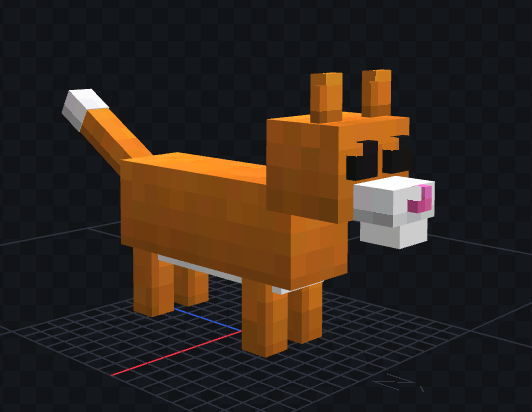

# MCModel Bedrock Skill (AI Agent)

This Antigravity skill powers an MCP server capable of automatically generating highly detailed 3D Minecraft Bedrock models (`.geo.json`) and accompanying texture atlases (`.png`) entirely through AI reasoning and geometric code generation.

## Features

- **Entity & Block Generation:** Automatically constructs hierarchical 3D models (Bones & Cubes) for both interactive Entities (mobs, vehicles) and static Blocks (furniture, machines).
- **Z-Fighting Resolution:** Employs advanced micro-translation algorithms to definitively resolve coplanar overlaps and Z-fighting issues natively within Bedrock geometry.
- **Java Mod Support:** Includes a `--java-model` flag (`--v26.3`, etc.) to format the JSON syntax for engines like GeckoLib, enabling compatibility with Minecraft Java mods.
- **Organic Volumetric Shading:** Calculates dynamic top-to-bottom shading gradients coupled with pixel-perfect white noise dithering (`shaded` style) to simulate thick fur, smooth car paint, and true 3D depth, completely eliminating chunky value noise artifacts.
- **Facial Rigging Logic:** Enforces explicit facial structures (3D eyes, separated jaws, inner mouths, snouts) for all living creatures, generating animation-ready hierarchical rigs.
- **Sub-pixel UV Mapping:** Resolves standard UV texture bleeding by utilizing precise mathematical offset rounding, mapping floating-point cube dimensions perfectly onto an integer-based pixel atlas.

## Showcase

Here are some models generated 100% autonomously by the AI using this skill:

### High Detail Cat


### Mecha Robot


### Anvil & Forge


### Campfire Spit


## Installation

This skill is designed for the Antigravity (AGY) ecosystem. 
Ensure you have the AGY MCP Server capabilities enabled.

```bash
npm install
```

## Usage

Simply ask the AI agent to build a model!

**Prompt Examples:**
- "Tạo entity model con mèo độ chi tiết cao"
- "Tạo block model ghế của sếp"
- "Tạo mô hình siêu xe dạng --java-model --v26.3"

The skill will infer the correct bones, dimensions, color palettes, and texture styles automatically.
