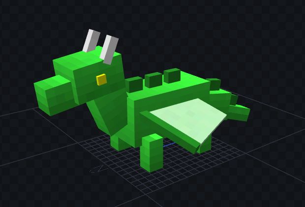
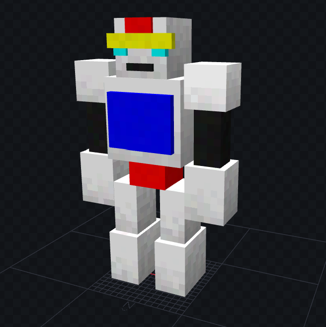
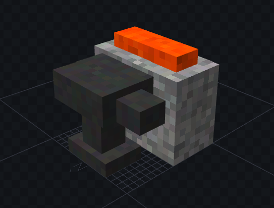
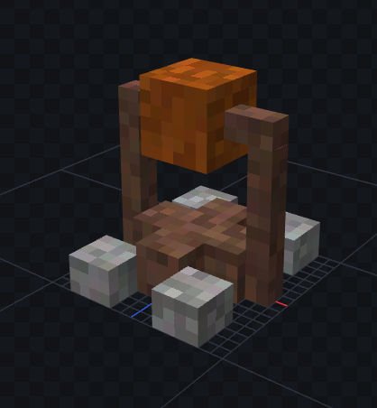

# 🧊 MCModel Bedrock Skill (AI Agent)

An advanced **Model Context Protocol (MCP)** server and AI Skill that allows Vision-Language Models (LLMs) to automatically generate highly detailed 3D Minecraft models (`.geo.json`) and procedural texture atlases (`.png`). 

It supports both **Image-to-3D** (vision-based generation from a reference image) and **Text-to-3D** (creative generation from pure text description).

## ✨ Features

- **Universal MCP Support:** Native integration with modern AI IDEs and CLIs including **Cursor, Claude Desktop, Roo Code (Cline)**, and the Antigravity (AGY) ecosystem.
- **Image-to-3D & Text-to-3D:** Provide an image for the AI to replicate its 3D structure, or simply describe what you want and let the AI act as a creative 3D engine.
- **Entity & Block Generation:** Automatically constructs hierarchical 3D models (Bones & Cubes) for interactive Entities (mobs, vehicles) and static Blocks (furniture, machines) that strictly follow Minecraft's engine limits.
- **Java Mod Support:** Includes a `--java-model` flag to format the JSON syntax for engines like GeckoLib, enabling compatibility with Minecraft Java mods.
- **Z-Fighting Resolution:** Employs advanced micro-translation algorithms to definitively resolve coplanar overlaps and Z-fighting issues natively within the geometry.
- **Organic Volumetric Shading & Texturing:** Calculates dynamic top-to-bottom shading gradients coupled with pixel-perfect white noise dithering (`shaded` style, `bordered` style, etc.) to simulate thick fur, smooth metal, and true 3D depth.
- **Sub-pixel UV Mapping:** Resolves standard UV texture bleeding by utilizing precise mathematical offset rounding, mapping floating-point cube dimensions perfectly onto an integer-based pixel atlas entirely autonomously.

---

## 🚀 Installation & Integration

This project is a standard Node.js MCP Server. 

1. **Install dependencies:**
   ```bash
   cd mcmodel-bedrock-skill
   npm install
   ```

2. **Integrate with your AI Assistant:**
   Because this project exposes both the `build_minecraft_asset` tool and the `mcmodel-bedrock` system prompt via MCP, it can be instantly plugged into any compatible AI tool.
   
   👉 **Read the [MCP_GUIDE.md](./MCP_GUIDE.md)** for 1-minute setup instructions for:
   - **Cursor IDE**
   - **Claude Desktop**
   - **Roo Code (Cline)** / VSCode Extensions

   👉 **Read the [INSTALL.md](./INSTALL.md)** for deep-dive integration into custom Node.js backends, OpenAI Function Calling, and Blockbench importing.

   👉 **Read the [SKIN_SKILL.md](./skills/mcmodel-bedrock-skill/SKIN_SKILL.md)** for Minecraft Player Skin generation guidelines (Masterpiece Standard v2.0 with Clustered Shading & Dual-Layer Depth).

---

## 🎮 Usage & Command Syntax

Once connected to your AI assistant, you can simply ask it to generate models in natural language or use the explicit command syntax:

```text
/mcmodel [--block | --entity] [--texture] <description>
```

**Flags:**
- `--block`: Static block model, 16x16x16 standard box, hard limit 30x30x30. (Default)
- `--entity`: Animatable entity with an articulated bone hierarchy and visible bounds.
- `--texture`: Generates a matching procedural `.png` texture alongside the model.
- `--java-model`: Configures the model to be compatible with Minecraft Java mods (like GeckoLib).

**Prompt Examples:**
- *"Use the mcmodel-bedrock prompt to generate a highly detailed entity model of a mutant fox with glowing eyes and an open jaw. Generate textures."*
- *[Attach an image]* *"Create a block model of this crystal flower."*
- *"Design a modern sports car entity model. Please format it as a `--java-model` using `--v26.3`."*

The AI will intelligently infer the correct bones, dimensions, structural logic, color palettes, and texture styles automatically before calling the generator tool.

---

## 🖼️ Showcase

Here are some models generated 100% autonomously by the AI using this skill:

### Mini Green Dragon


### Mecha Robot


### Anvil & Forge


### Campfire Spit


---
*Built for the AI-assisted Minecraft Creator community.*
*project created by AI*
